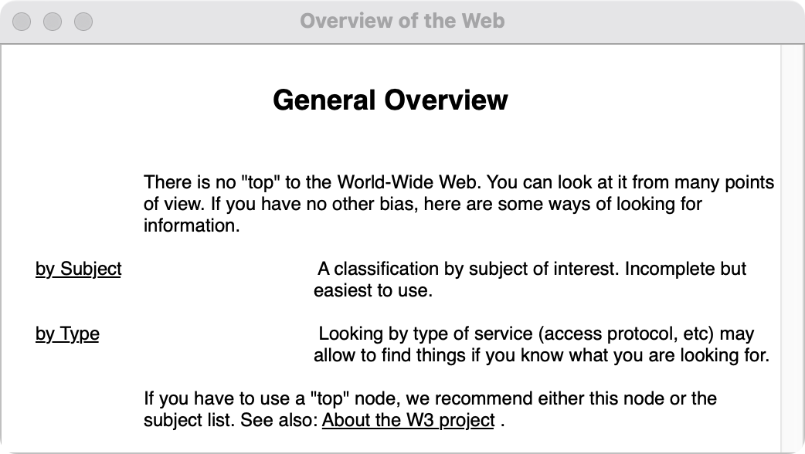

# WorldWideWeb for modern macOS

A source port of WorldWideWeb, the first web browser and HTML editor,
written by Tim Berners-Lee at CERN on a NeXT from 1990-1992.

This source port builds from TBL's original Objective-C and C files.
As little change as possible was made to the original code. A small
NeXTSTEP 3 compatibility layer was used to translate certain missing
interfaces, like `Object`, `List`, and `NXStream`, to modern AppKit.

The original .nib files were decoded to reimplement them in Objective-C.
You can see the decoded specification in docs/nib-spec.txt.

The original source comes from
[cynthia/WorldWideWeb](https://github.com/cynthia/WorldWideWeb), which
archives the files from the NeXT distribution of version 0.15–0.16.



## Build and run

You need the Xcode command line tools (`xcode-select --install`).

```bash
make
```

```bash
open build/WorldWideWeb.app
```

The home page is TBL's `default.html`. Double-clicking link follows it,
as on the NeXT. Navigate > Back (Command-^) goes back. Some pages still work
on today's web: `http://info.cern.ch/hypertext/WWW/TheProject.html` is the
restored first website, which you can open with Document > Open given
document address. 

WorldWideWeb.app predates TLS, so naturally no HTTPS websites work.
Many websites will cause the app to hang, as it doesn't support modern HTML,
and cannot connect to anything that requires >HTTP1.0.

A small proxy-server that translates basic HTML to SGML might be useful
to get some simple websites loading.

To see the console trace TBL used, start the app from a terminal with
`WWW_TRACE=1`.

## Test

```bash
make test
```

This runs a headless test, reading the bundled pages through TBL's HTML
parser, prints the runs of text with their styles and links, and writes each
page back out as HTML.

`build/htmltest` also takes `http:` addresses.

## Layout

| Path | What |
|------|------|
| `original/` | The original source, untouched |
| `src/` | TBL's files, ported. Every change is marked `Port:` |
| `src/compat/` | The NeXTSTEP compatibility layer |
| `src/WorldWideWeb_nib.m` | The interface from `WorldWideWeb.nib`, rebuilt in code |
| `docs/nib-spec.txt` | Every window, menu and connection in the nib, decoded |
| `tools/` | The nib decoders that made `docs/` and `resources/` |
| `resources/` | Texts extracted from the nib |

See [PORTING.md](PORTING.md) for what changed and why.

## Licence

The original code is Copyright 1990–1995 CERN and MIT, under the W3C/CERN
licence in [NOTICE](NOTICE). The port is under the same terms. This product
includes computer software created and made available by CERN.
